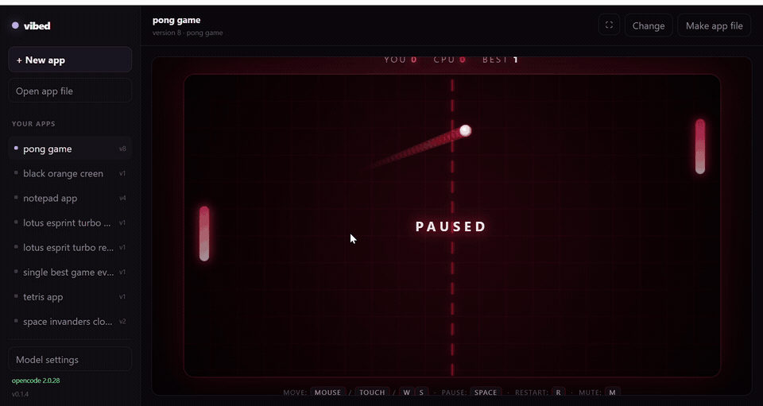

# Vibed

**A blank app that becomes whatever you describe, and stays changeable forever.**

Download the shell once. It opens as a black canvas. You type what you want, and it becomes that app. Type something else later, and it becomes that instead. Nothing is ever finished, and nothing is ever locked.



## Try it

Windows, ~100 MB, unsigned (SmartScreen will complain).

1. Download `Vibed.exe` from [releases](../../releases) and run it.
2. Open **Model settings** and paste an OpenRouter key — or use a local OpenCode install and pay nothing.
3. Type what you want on the canvas, then **Make app file** to send it to someone.

The person who receives the file double-clicks it and the app runs. No install, no account, no key needed to run it.

---

## The idea

Most software is a finished object. You pick it from a list, install it, and live with the shape someone else chose.

Vibed is the opposite. You keep one thing, and it takes the shape you need, then a different shape when your needs change. The app is clay, not a statue.

Two rules follow from that:

1. **An app is a folder you own.** Source, data, and the previous version all live inside it. Copy the folder and the app moves with you. Zip it and it travels.
2. **The source always travels with the app.** The moment an app ships without its source, it stops being changeable.

---

## How it works

There are three pieces.

**The shell** is the app you run. It hosts whatever app you currently have open, and it turns an app into a single file you can send to someone.

**The app folder** is one app. It looks like this:

```
My Habit Tracker/
  app.json          name, intent, version
  source/           index.html and friends
  data/             data.json, saved from localStorage
  previous/         one copy per accepted change
```

**The app file** is what you send. From the packaged build, **Make app file** bakes the current app into one self-extracting `.exe`. The recipient double-clicks it, it unpacks the app into their library, and it runs. They can change it too, with their own OpenRouter key or their own OpenCode install.

The shell and the exported app are the same program. One runs from a folder, the other unpacks itself first. There is no installer and no separate player to download.

**The stack.** React 18, TypeScript, and Vite for the window; Electron main in CommonJS; Vitest for tests. Generated apps are plain web code, and they can use React or Three.js from the same install.

---

## Try it

Requires Node.js 22+.

```powershell
npm install
npm run dev
```

`npm run web:dev` runs only the UI in a browser; app generation and app folders need the desktop shell.

Then open **Model settings**. **OpenRouter** is the default: one key, one balance, any model.

- **OpenRouter** — paste a key from `openrouter.ai/keys` and Vibed calls `https://openrouter.ai/api/v1`. The default model is `deepseek/deepseek-v4.1-flash`, about $0.05 per million input tokens, so a whole app costs a fraction of a cent. Any OpenRouter model id works, including `:free` variants where one exists.
- **OpenCode** — if `opencode` is on your PATH, creation and changes run through it. It uses your own OpenCode sign-in, so free models work and no key is stored. Set the model under **CLI model**. With no CLI, this provider instead calls OpenCode's own endpoint with an OpenCode key.
- **OpenAI, DeepSeek, Ollama, Custom** — the older endpoints, still selectable. Ollama needs no key at all.

The key, if used, stays in the main process in `safeStorage`. It is never written into an app or an exported `.exe`. Switching providers keeps the stored key, so replace it when you change provider.

The CLI path never touches your app folder directly. It copies `source/` into a temporary workspace with a config that denies shell, web, and anything outside that folder, then reads the result back and validates it. A failed change is discarded with the workspace.

Validation:

```powershell
npm run check
npm test
npm run build
```

Packaged build:

```powershell
npm run dist
```

That writes `release\Vibed.exe`, a single portable file. Run that copy and **Make app file** produces a real single-file app `.exe`; running from source writes a `.zip` instead, because there is no packaged shell to copy.

## Updates

Vibed checks `frazik-main/.vibed` releases once at startup. The sidebar footer has a **Check for updates** button; when a newer tag exists it becomes **Update to vX.Y.Z** and opens the release page. The same button runs the check again when no update is waiting.

This is not auto-update: `npm run dist` produces a **portable** exe and electron-updater cannot replace a portable build in place. Auto-update would mean switching to the NSIS target and signing the installer. The check only opens a page; it never downloads or installs anything.

## Using it

1. Open **Model settings** and paste an OpenRouter key, or choose OpenCode if you have its CLI. **Check again** re-probes for the CLI. If you do not have a key, **How do I set this up?** walks you through getting one.
2. Type what you want on the canvas and press **Create it**. A log shows each stage while it works; **Cancel** stops it and keeps your prompt.
3. **Ctrl+E** changes the running app. The previous source stays in `previous/`.
4. The ⛶ button goes full screen. In full screen, an **Update app** bubble sits in the bottom-right; click it to leave full screen and open the change dialog. F11 toggles full screen from inside the app. Exported apps start in full screen.
5. **Make app file** writes the app out; **Open app file** brings an exported app back in.
6. **Escape** leaves full screen, including when pressed inside the app frame.
7. **Logs** in the sidebar footer shows recent calls and errors; **Open file** opens `vibed.log`.

---

## What exists today

This is the MVP described in this repo, not the finished product.

- A desktop shell with a canvas, an app list, and an isolated app frame.
- Create an app from a written description.
- A live stage log and a **Cancel** button while an app is being created or changed. Cancelling keeps your prompt and changes nothing.
- A **Logs** view in the sidebar footer with recent model calls, connection errors, and the path to `vibed.log`.
- An update check at startup, with a **Check for updates** / **Update to vX.Y.Z** button in the sidebar footer.
- Change an app by describing the change. The previous source is kept in `previous/`.
- App data is saved to `data/data.json` and restored on open.
- Full screen for the running app, from a button in the shell. Exported apps start full screen with an **Update app** bubble in the bottom-right that opens the change dialog.
- Export an app to a file: a `.zip` from source, or a self-extracting `.exe` from the packaged build. Open either one again.
- A self-extracting container format with a footer, plus tests for tampering and path safety.

Generated apps can use:

- Plain HTML, CSS, and JavaScript.
- Canvas 2D and WebGL with no library at all.
- React 18 with `htm` instead of JSX, loaded from `vibed-lib://react/...` and `vibed-lib://htm/...`.
- Three.js r186, imported from `vibed-lib://three/build/three.module.js`.

Those libraries ship with the shell instead of the app. They work offline, they travel inside an exported app, and the app still has no network access. The shell is React too, so the whole project is one JavaScript stack.

Known limits, stated plainly:

- Export works in both modes: from source it writes a `.zip`, and from `release\Vibed.exe` it writes a self-extracting `.exe`.
- The packaged build is unsigned, so Windows SmartScreen may warn on first launch.
- Generation rewrites the whole file set on every change. That is simple, and it is the main quality risk.
- The library set is fixed. Apps cannot add their own npm packages.
- No Git, no agent tools, and no permission broker yet.
- `data.json` is flushed by the app frame on a timer and on close, so a hard crash can lose the last second of input.

---

## Path to the full idea

The MVP is deliberately small. These are the steps that turn it into the product, in the order they matter.

1. **Signing and trust.** Sign the portable build and exported files, and verify them on open. Decide the policy for appended payloads, since they invalidate a signature over the base executable.
2. **A smaller shell.** Electron makes every app file ~150MB. A Tauri or custom shell would make sharing practical.
3. **Real editing.** Replace whole-file regeneration with a proper agent loop (OpenCode) that edits the files it needs to edit, runs the app, and checks the result before proposing it.
4. **Checks and tests.** Every app should carry a smoke check, and a change should not be accepted when the check fails.
5. **History.** Replace `previous/` with a hidden local Git repository per app: linear commits on accept, restore from the app UI, no remotes.
6. **Permissions.** A capability broker so apps can ask for network, files, or notifications, with the user granting and revoking them.
7. **Sharing.** A registry or index, forks with lineage, and update checks. Never a silent change.
8. **Games.** Deterministic input and save tests once the app runtime is stable.

Each step has a place in `docs/roadmap.md`, with the reason it comes where it does.

---

## Documents

- [Vision](docs/vision.md): what this is and who it is for.
- [Architecture](docs/architecture.md): processes, folders, isolation, model boundary.
- [Format](docs/format.md): the app folder and the portable container.
- [Roadmap](docs/roadmap.md): what comes next and why.

## Working principle

**Boundaries before prompts.** A model can suggest code, but it is not an authorization system. Trusted shell code decides what is allowed, and the app frame enforces it.

## License

MIT — see [LICENSE](LICENSE).
